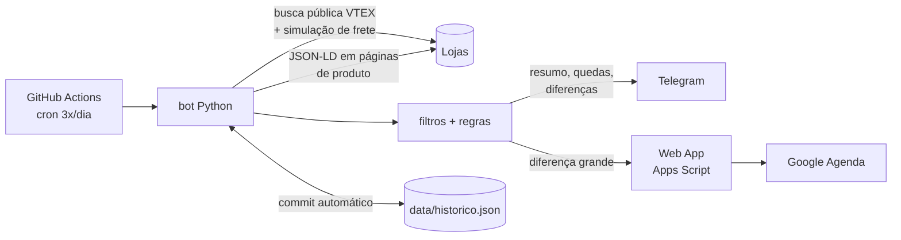

# ❄️ Monitor de preços de ar-condicionado

Bot que vigia lojas online atrás de **ar-condicionado split inverter, só frio, 220V, 9.000 ou 12.000 BTUs**
das marcas **Gree, Midea e Elgin**, dentro de um teto de preço. Avisa pelo **Telegram** e, quando o mesmo
modelo está muito mais barato numa loja do que em outra, cria um **evento no Google Agenda**.

Projeto pessoal de estudo de **DevOps**: agendamento com GitHub Actions, CI com testes automáticos,
gestão de segredos, integração entre serviços (Telegram, Google Apps Script) e coleta de dados
responsável na web.

## Arquitetura



## Estrutura

| Caminho | Papel |
|---|---|
| `config.yaml` | Toda a regra de negócio: marcas, BTUs, teto, lojas, modelos, limites de alerta |
| `bot/http_educado.py` | Cliente HTTP "bom cidadão": robots.txt, intervalo, teto de requisições, respeita bloqueios |
| `bot/extratores.py` | Lê a busca VTEX, a simulação de frete e o JSON-LD das páginas |
| `bot/filtros.py` | Decide se o anúncio é o aparelho certo (marca, inverter, BTU, só frio, 220V) |
| `bot/regras.py` | Teto, regra do 12k, frete, queda de preço, diferença entre lojas |
| `bot/notificadores.py` | Telegram e webhook da agenda |
| `bot/historico.py` | Memória entre execuções (`data/historico.json`) |
| `bot/main.py` | Orquestra tudo; modos `--simular`, `--diagnostico`, `--testar` |
| `apps_script/Codigo.gs` | Web App que cria o evento no Google Agenda |
| `.github/workflows/monitor.yml` | Execução agendada |
| `.github/workflows/ci.yml` | Lint + testes a cada push |
| `tests/` | Testes automáticos (pytest) com dados de exemplo |
| `docs/GUIA_PASSO_A_PASSO.md` | Tutorial completo de implantação, do zero |
| `docs/DECISOES.md` | Registro das decisões de arquitetura (ADRs) |

## Uso rápido

```bash
pip install -r requirements-dev.txt
python -m pytest -v                 # testes
python -m bot.main --diagnostico    # quais lojas respondem
python -m bot.main --simular        # roda tudo sem enviar nada
```

## Princípios

- **Educado, não furtivo** — identifica-se, obedece `robots.txt`, espaça as requisições e desiste quando o site recusa (ver ADR-003).
- **Segredos fora do código** — tudo em GitHub Secrets; nada sensível nos logs públicos (ADR-006).
- **Configuração separada do código** — mudar critério é editar YAML, não Python.

## Status e próximos passos

- [ ] v1 em produção
- [ ] v2: Mercado Livre via OAuth com renovação automática do token
- [ ] Fixar Actions por commit SHA
- [ ] Histórico em SQLite e gráfico de preços

## O que aprendi

_(preencha ao final — é a seção que um recrutador mais lê)_
